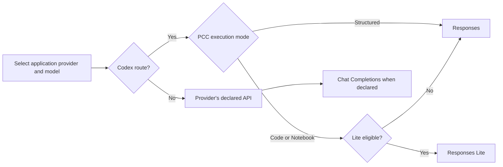

# Models, routes and what a pass means

We test OpenAI Codex through Responses and Responses Lite, and other providers through their declared APIs, including Chat Completions. Switching a model name alone does not establish that a different route was exercised.

## Switching the application, not the reviewer

The reviewer runs in its own host Pi session. Inside the guest it selects the application's provider and model separately. Interactive scenarios use Pi's model selection and extension settings. Headless scenarios set the model through `createAgentSession` and use the guest agent directory's settings. Transition scenarios change the model in the same session so that notes ownership, tools and retired history are exercised across the switch.

The settings we vary are:

| Setting | What it changes |
| --- | --- |
| Provider and model | The backend, model capabilities and declared API |
| PCC execution mode | Structured tools, Code or Notebook |
| PCC provider scope | Whether Code or Notebook also adapts a non-Codex provider |
| Notes activation | All models or an exact model whitelist |
| Continuity owner | Notes, or PCC's own Local, Tree or Remote context management |

For non-Codex Code and Notebook checks, PCC's **all providers** scope keeps the selected model's declared API. It does not turn Chat Completions into Codex Responses. For PCC Remote checks, Notes must not take over continuity in that test session.

Recent live checks used `openai-codex/gpt-6-sol`, OpenRouter's `cohere/north-mini-code:free` and a Dots preview model through OpenRouter. Those are examples of models we exercised, not a permanent test-model list. We check the current catalogue, capabilities and pricing before choosing a route. A free model's tool-support claim still needs a real tool call and result-consumption check.

## Responses Lite is a request format

PCC selects Lite automatically for eligible Codex models in Code or Notebook. Structured mode uses regular Responses. The current [model gate](../../packages/pi-codex-conversion/src/providers/openai-codex/responses-lite-model.ts) and [runtime plan](../../packages/pi-codex-conversion/src/adapter/activation/runtime-plan.ts) define eligibility.

We inspect the request rather than treating the Notebook setting as proof. A fresh Lite request has an `additional_tools` input item and no top-level `tools` or `instructions`. The [Lite transformation](../../packages/pi-codex-conversion/src/providers/openai-codex/responses-lite.ts) owns that format. HTTP streaming and WebSocket are separate transport choices, not synonyms for Responses and Lite.

Codex's Remote notes and history also need actual Codex backend acceptance. A successful OpenRouter tool call cannot establish that the reserved namespaces, encrypted arguments or nested result delivery work there.

## Three different kinds of evidence

| Test | What it tells us |
| --- | --- |
| Real Pi with a controlled boundary fixture | Whether the application handles the injected event, timing or failure |
| Real Pi with a live provider | Whether that backend accepts the tested contract and completes the application workflow |
| A small direct SDK model call | Whether the account, model and basic tool-result exchange work before the application test |

For live tool checks, we use a value the model cannot know in advance, such as a nonce generated when the tool executes. The response must use the returned value. Ordinary text from the backend is not proof of tool support.

We inspect model-visible instructions and native tool schemas separately from nested `ALL_TOOLS` discovery. A callable nested tool does not prove its description reached the model.

## Reading failures without overclaiming

The reviewer separates backend rejection, application failure, model choice and a faulty fixture. We have retracted apparent product failures after discovering that a fixture omitted production reasoning metadata or supplied conflicting token-limit fields.

Likewise, a model succeeding after clarification establishes recovery. If that clarification remains in the history during a retest, it does not isolate the effect of a prompt edit. We record the limitation instead of turning the retest into a clean comparison claim.

Short headless acceptance checks do not establish long-context auto-compaction, all model families or interactive UX. A fixture can cover a retry path while live backend acceptance remains untested. The report keeps those distinctions alongside the result.
